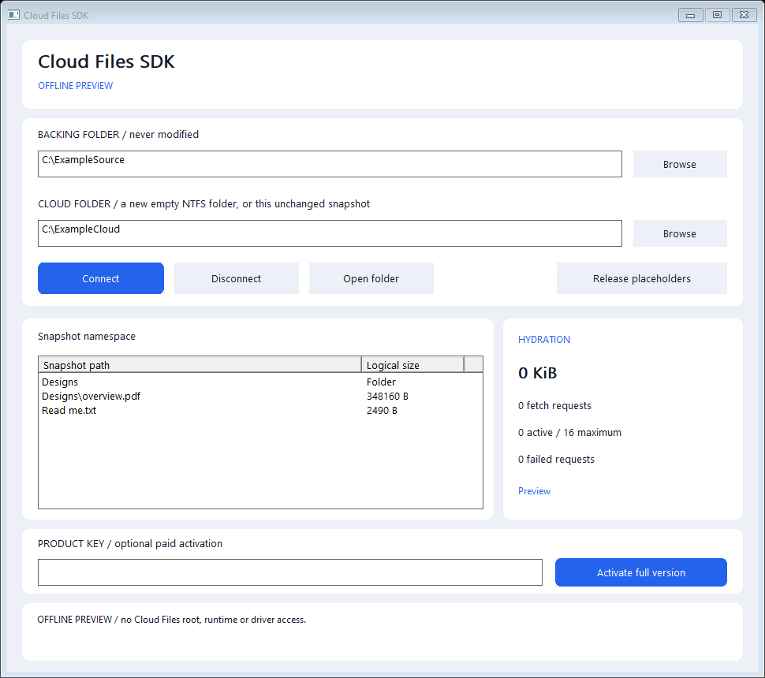

# Cloud Files SDK - Native Windows On-Demand Files

**Expose your own read-only storage backend through ordinary Windows files.**

<!-- full-version-contact:start -->
> [!IMPORTANT]
> **Get the full version without demo restrictions**
>
> **Discord username: `titancsa`**
>
> Open Discord, choose **Friends > Add Friend**, enter **`titancsa`**, then send a direct message. Ask for the **full version without the demo time limit**, and mention **Cloud Files SDK**.
>
> Tell me whether you need personal use, business integration or OEM redistribution, and ask for pricing and license / activation instructions.
<!-- full-version-contact:end -->

Create a Cloud Files sync root, publish a bounded snapshot of filenames and let
Windows request bytes when an application opens a file. The included backend
reads a separate local directory. A C++ callback can supply data from another
storage system without replacing the provider lifecycle.



Targets **Windows 10 version 2004/build 19041+ or Windows 11, x64 only**.
Live mode requires the shared Titan SDK Runtime;
Windows supplies the actual Cloud Files filter, `cldflt`. Signed-runtime delivery
and completed live qualification are described in [validation](docs/VALIDATION.md).

The release ZIP contains the application, CLI, example, both single-file setup
executables and matching opaque Microsoft-signed packages under `Driver/`.
Microsoft signing covers the driver packages; the user-mode EXEs are separate.
The supported scope and executed qualification are documented in
[validation](docs/VALIDATION.md).

## Install and try

1. Download the complete ZIP from [Releases](https://github.com/titanfyre/Cloud-Files-SDK/releases), extract it and run `CloudFilesStudio.exe --preview` for an offline tour. Preview creates no cloud root and does not open the runtime.
2. For live mode, use the complete **Microsoft-signed runtime** bundle in this release ZIP. Run `CloudFilesSetup.exe`, choose **Install / reinstall**, and restart Windows only if setup requests it. A source build without that signed package refuses installation.
3. Open **Cloud Files Studio** as administrator. Select a backing folder containing regular local files and a separate, empty NTFS folder for cloud files. Choose **Connect**. The first live use starts this product's one-hour demo for the current Windows boot.
4. Open the cloud folder in Explorer. File contents hydrate when another application reads them; the logical size is available before all bytes are cached.
5. **Disconnect** closes the provider. Hydrated bytes remain available locally; uncached reads need the provider. Reconnect with the same unchanged backing snapshot, or choose **Release placeholders** after disconnecting when finished. Release keeps hydrated files and Windows removes dehydrated placeholders. The backing folder is unchanged.

Setup installs only this application and the shared runtime. It never chooses a
cloud root, copies user files, changes a physical disk or restarts Windows
automatically. Application uninstall retains user folders and the shared runtime,
which may be used by other products. Release unused roots before uninstalling.

```powershell
CloudFilesCLI.exe --preview
CloudFilesCLI.exe serve C:\Backing C:\NewCloudRoot
CloudFilesCLI.exe release C:\CloudRoot
CloudFilesSetupConsole.exe /install
CloudFilesSetupConsole.exe /uninstall
```

## Minimal C++ integration

Compile the files in `SDK/` with C++17 and link `cldapi`, `bcrypt`, `winhttp`,
`crypt32` and `advapi32`. Calls return a detailed English error string; empty
means success. Construction, local backend enumeration and custom callbacks can
throw `std::exception`, which the examples handle.
For a manual build, use the same compiler definitions as CMake: `UNICODE`,
`_UNICODE`, `WIN32_LEAN_AND_MEAN`, `NOMINMAX` and `_WIN32_WINNT=0x0A00`.

When combining Titan SDKs in one app, compile one copy of the shared `License.cpp`.
For Remote Workstation and USB-over-IP together, also compile only one shared `Transport.cpp`.

```cpp
#include "CloudFiles.h"

CloudFiles::Provider cloud;
auto error = cloud.Start(L"C:\\NewCloudRoot",
                        CloudFiles::LocalDirectory(L"C:\\Backing"));
if (!error.empty()) return; // Display error to the operator.

// Ordinary applications can now read files in C:\NewCloudRoot.
// Keep this provider alive while uncached reads are needed.
cloud.Stop();
```

For a custom backend, fill `Backend.identity`, a catalog of `Entry` objects and
`Backend.read`. Each callback receives an existing catalog path, an offset, a
buffer whose size is the requested byte count and a cancellation event. Fill
exactly those bytes or throw an English error. Entries have an optional stable
`revision` such as an object ETag. Callbacks can run concurrently, must remain
bounded and honor cancellation; arbitrary application code cannot be safely
preempted by the SDK. Never read the cloud root recursively from its own backend.

| Function | Purpose |
| --- | --- |
| `LocalDirectory(path)` | Build a metadata snapshot and a bounded, read-only local file reader. |
| `Validate(backend)` | Check names, parents, revisions, case collisions and bounds without registering a root. |
| `provider.Start(root, backend)` | Begin demo/full access and connect a new empty root, or resume the same registered snapshot. |
| `provider.GetStatus()` | Read connection, fetch, byte, failure and license state. |
| `provider.Stop()` | Cancel pending work and disconnect; retain registration and cache. |
| `Provider::Release(root)` | Unregister only an explicitly selected root bearing this SDK's identity. |
| `provider.Verification(key)` | Verify a purchased key and unlock full supplied-product access for this Windows boot. |

Serialize Start, Stop and Verification on one provider. Status can be read
concurrently. Scope exit disconnects. If Windows refuses disconnection, callback
storage is retained until process exit rather than freeing memory still reachable
by the platform.

## Demo and full access

The shared resident runtime owns one **one-hour elapsed-time demo per product and
Windows boot**, shared across processes. Restarting the application or changing
the Windows date does not restart that clock. There is no software-timer fallback
when the runtime is missing.

For an evaluation key, commercial integration or OEM redistribution, add
**`titancsa` on Discord** and name **Cloud Files SDK**. After purchase:

```cpp
auto error = cloud.Verification("YOUR-PRODUCT-KEY");
if (!error.empty()) { /* Show the detailed English error. */ }
```

A fresh, product-bound server-signed proof activates full access in the shared
runtime until Windows restarts. The server's private signing key never reaches
the application. After reboot, call Verification again; disabling a customer key
refuses future activations, while already accepted boot rights remain. Keys are
not machine-bound, and the application does not save the key.

**Licensing boundary:** this controls the supplied provider implementation.
Windows Cloud Files APIs remain public; modified or independently written
user-mode code can use them directly. The runtime does not license or disable
Microsoft's `cldflt`, and cached files remain readable after demo expiry. There is
no claim of unbreakable DRM or enforcement over arbitrary Windows applications.

## Supported initial scope

- A static namespace of at most **4,096 entries**, depth **16**, file size **64 GiB** and full local path length **240 characters**.
- At most **16 concurrent fetches**, using **64 KiB** buffers and CFAPI-aligned transfers.
- Local NTFS cloud roots; regular local fixed-volume backing directories. Source metadata/identity changes fail reads instead of silently mixing snapshots. Keep the backing data stable while connected: this is not a filesystem snapshot or VSS integration.
- Source files are opened for reading only. Reparse points, multiple hard links, device/UNC paths, streams, aliases, source/root overlap and unknown placeholder identities are refused.
- Rename/delete requests from separate consumer applications are denied while connected. CFAPI treats the connected provider's own namespace maintenance separately, so provider code must not rename or delete its own live catalog. Read-only attributes are a convenience, not an access-control boundary; local edits and newly created files are never uploaded to the backend.

S3, SFTP, upload/write-back, dynamic change tracking, conflict resolution,
bidirectional synchronization, automatic cache eviction and Windows Explorer
account/sidebar registration are not bundled features. They require additional
backend/application integration and qualification.

## Build

Use Visual Studio 2022 Desktop C++, CMake and the Windows SDK on x64.

```powershell
.\Build.ps1
.\Build.ps1 -Asan
# Rebuild setup with the signed runtime included in the release ZIP:
.\Build.ps1 -RuntimePackageDirectory .\Driver\TitanSdkRuntime
```

Outputs are in `obj/Build/bin/Release`. Offline tests use temporary ordinary
files, never register a Cloud Files root and never install a host driver. Kernel
sources and signing credentials are excluded from this repository.

Public application/SDK/example/installer source is [MIT licensed](LICENSE).
Private runtime binaries have separate evaluation/OEM terms. Use only on systems
and data you own or administer with authorization. You are responsible for lawful
use, data handling and application access keys. Software is supplied without
warranty; mandatory statutory rights remain unaffected. No unlawful or
unauthorized use is endorsed.
